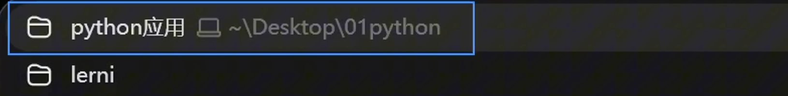
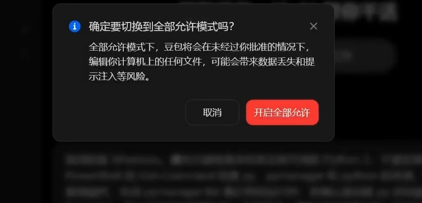

# 安装环境与首次运行

[返回第一课](../README.md) · [完整手册](完整图文手册.md) · [分步提示词](../提示词/README.md)

本页沿用完整手册的章节编号；提到其他节时可打开完整手册查阅。第 07 节“直接运行源码”是可选路线。

# 01 先选一条学习路线

想学会从想法做成软件，请走路线 A；想先看看成品能做什么，请走路线 B。两条路线最后都要亲手完成加密、还原和内容核对。

## 路线 A 从需求开始做

按本手册第 02 至 05 节完成项目、Python 和需求准备；再在第 06 节确认计划并开工。每次只发送当前步骤的提示词，检查结果后再继续。

## 路线 B 先运行配套源码

跳到第 07 节，把随包源码解压到本机固定目录，重新创建项目环境，再运行 main.py。已经提供的代码不需要重新让 AI 生成，也不要把你正在跟课的新项目直接覆盖掉。

| 资料 | 用途 |
| --- | --- |
| 图文手册 | 在线阅读本文件；离线 Word 从本课网盘入口下载。 |
| 提示词 | 本课提示词目录提供在线阅读版和 TXT；Word 位于离线包。 |
| 源代码与图标 | 课堂代码、运行依赖、ICO 和 PNG 图标，以及项目文档。 |
| 练习文件 | 虚构文本和含子目录的文件夹；另附练习说明与检查清单。 |

建议先把整个资料包解压，避免在压缩包预览里直接运行。给项目和练习输出分别建目录；把路径放在你能找到的固定位置。

阅读顺序：项目与环境 → 需求与开发 → 加密与还原 → 排错与交付。在线按标题查阅；离线 Word 可使用导航窗格。

# 02 在工作页签选择自己的项目

准备一台 Windows 电脑，安装并登录豆包桌面端。官方入口是 https://www.doubao.com/download/desktop 。本课实际使用的是“工作”页签；如果你当前账号没有这个入口，先核对客户端和功能开放情况，不用普通聊天页面硬套后面的文件操作。


1. 在电脑上新建一个空文件夹，例如桌面上的 01python。这是你的项目位置。

2. 在豆包工作任务的输入框附近找到项目入口，选择这个文件夹。中下篇继续选同一个项目。

3. 让豆包说出当前工作区的完整路径，与你实际选中的文件夹核对。先确认位置正确，再允许创建或修改文件。



检查结果：你知道项目放在哪里，豆包显示的工作区也是它。界面里出现一个项目名字，不等于已经确认了完整路径。

# 03 先检查环境 再确认权限

打开提示词文档，先发 ①“检查本机 Python”。检查的对象是你自己的 Windows 电脑，不只是豆包内部能够运行代码的环境。让它返回实际版本、解释器路径和运行方式。

如果已经能运行，就直接做下一节的 Hello World。缺少或不能用时，再发 ②“需要时才安装”，让豆包先解释方案、来源和需要你操作的窗口。



1. 涉及安装、执行命令或写文件时，先看它准备做什么、要改哪里。

2. 跟做建议选择“始终询问”，再批准与你当前步骤一致的操作。视频中的“全部允许”是演示选择，不是完成本课的必要条件。

3. 看不懂时直接问：“请用普通人能懂的话说说会改什么、为什么需要改，先解释，不继续执行。”

检查结果：看到本机实际解释器的版本和位置；或清楚知道还缺什么。“我可以帮你安装”不算安装完成。Python 官方 Windows 下载页：https://www.python.org/downloads/windows/ 。

# 04 运行你的第一段 Python

确认环境可用后，发送提示词 ③“创建并运行 Hello World”。让豆包在项目中创建 hello.py，并用刚才核实的本机解释器实际执行。


1. 回到项目文件夹，确认 hello.py 确实存在。如果已有同名文件，先看内容，不直接覆盖。

2. 核对豆包给出的完整运行命令，确认运行的是你项目里的文件。

3. 看到 Hello, World!，且没有执行错误，才算这一步完成。能在普通 Windows 环境运行更有利于后面独立启动桌面工具。

## 如果结果不一样

找不到 Python：回到环境检查。找不到 hello.py：核对当前目录和文件名。只有代码没有运行结果：让豆包实际执行，或给出你能照做的具体命令。

```text
print("Hello, World!")
```

上篇的完成点：自己的项目能找到，自己的电脑能运行 hello.py。还没有做出加密工具是正常的，中篇才开始开发它。
