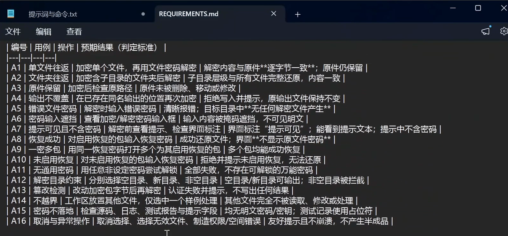
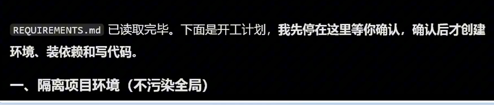

# 说清需求与生成工具

[返回第一课](../README.md) · [完整手册](完整图文手册.md) · [分步提示词](../提示词/README.md)

本页沿用完整手册的章节编号；提到其他节时可打开完整手册查阅。第 07 节“直接运行源码”是可选路线。

# 05 把想法写成可检查的需求

继续原项目，发送提示词 ④“先整理需求”。这一步先生成 REQUIREMENTS.md，不急着写应用代码。双击该文件，用记事本或编辑器阅读；.md 是文本文档，不是需要运行的程序。



1. 输入是什么：只选择一个文件或一个文件夹，不自动处理整块磁盘。

2. 输出是什么：生成新的 .pyenc 加密包；还原时放进你选择的空目录，原件继续保留。

3. 失败怎么办：密码输错、输出重名、目录非空要提示，不能把失败说成成功。

4. 恢复怎么用：加密时预先启用并另设恢复密码，恢复的是文件内容，不是显示原密码。

检查结果：需求文档中的行为与你想的一致。尤其确认“原件保留”“不覆盖输出”“文件夹子目录保留”和“恢复条件”。有偏差就先改需求，再开工。

# 06 看懂计划后再让豆包开工

需求核对完，发送提示词 ⑤。让豆包先读需求、核对项目目录、列出准备创建的文件和需要安装的依赖，说明采用哪一个 Python，然后等你确认。



1. 看到计划后，检查是否仍在你的项目内，是否只做需求约定的小工具。

2. 用独立项目环境安装依赖，避免把别的项目一起改掉。看不懂“环境”时，可以把它理解成这个工具专用的一套运行条件。

3. 确认后单独发送“按刚才确认的文件结构和依赖开始实现”。等待文件创建和实际检查完成。

4. 让豆包按 README 的方法启动工具。亲眼看到窗口后，确认有加密、解密或恢复入口，再进入下篇的实测。

| 文件 | 你需要知道的用途 |
| --- | --- |
| main.py | 启动程序的入口。 |
| ui.py | 窗口和按钮。 |
| crypto_core.py | 文件加密与还原逻辑。 |
| requirements.txt | 运行需要安装的第三方库。 |
| README.md | 启动方法与操作说明。 |

检查结果：文件真实存在，窗口能打开。AI 显示“完成”只是交付提示，窗口打开也不等于所有功能都已经测过。

# 07 直接运行资料包里的源码

这一节适合路线 B，也适合对照自己的项目。进入本课的 源代码，应该能看到 main.py、ui.py、crypto_core.py、requirements.txt 和 assets。不要只拷走 main.py。

最省心的方式是把这个文件夹选为豆包项目，再发送提示词文档中的 S1“运行已有源码”。让它先读 README，核对本机 Python，再建立新的 .venv 和安装依赖。另一台电脑的 .venv 已从正式包中排除，不能直接搬来使用。

## 自己运行时的步骤

先打开这个项目目录，在文件资源管理器地址栏输入 powershell 并回车。只有已经确认本机存在 Python 3.13、py -3.13 指向该解释器时，才按下面示例操作。若你使用其他已确认兼容的解释器，让豆包换成它的真实完整路径。

```text
py -3.13 -m venv .venv
.\.venv\Scripts\python.exe -m pip install -r requirements.txt
.\.venv\Scripts\python.exe main.py
```

每条命令成功后再执行下一条。安装需要网络；若依赖安装失败，保留完整错误，让豆包查原因，不要连续更换多个环境。

本包保留 cryptography==50.0.2。Python 3.13 是原录制环境的一条可复现路线，不要求已经正常的电脑强行更换版本。

检查结果：打开“此地无银”窗口，看到两个标签页。后面全部使用配套虚构样例，不直接拿重要文件试验。

这份源码针对 Windows 窗口和 ICO 图标编写。不要把 Mac 上通过的核心逻辑检查当成 Windows 桌面窗口已经验证。
