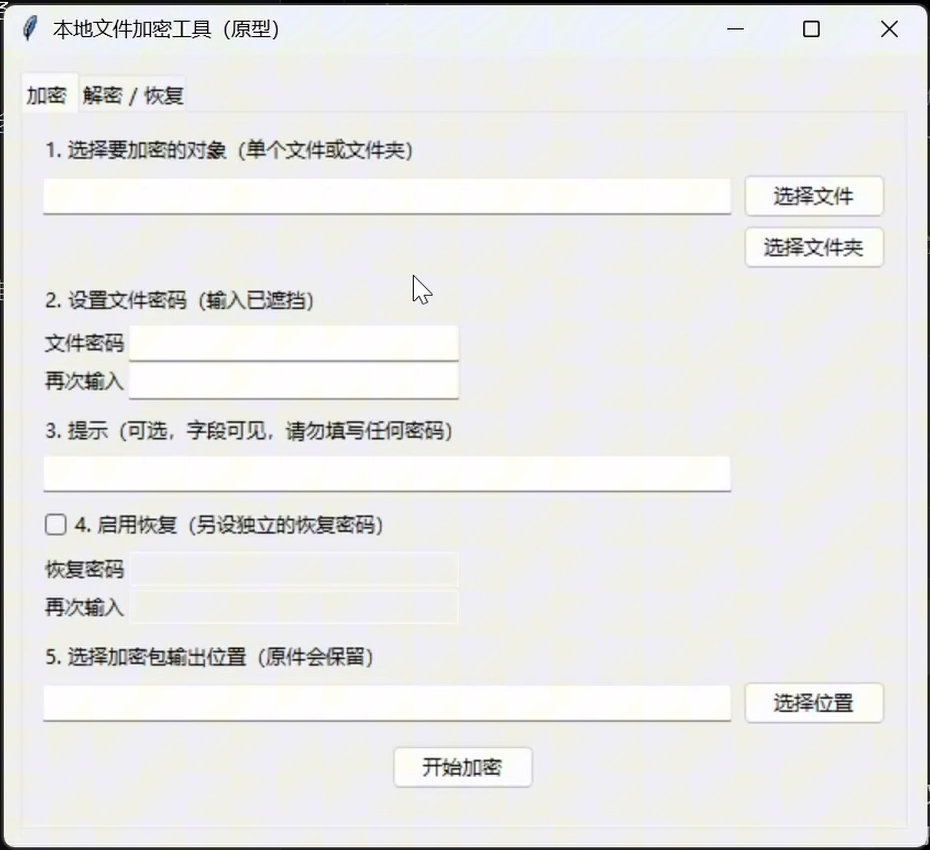
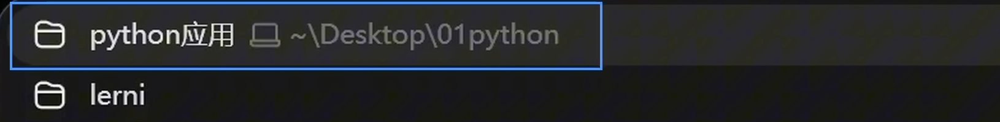
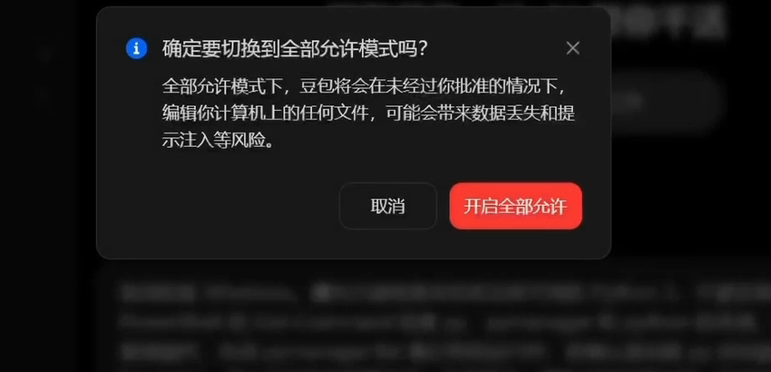
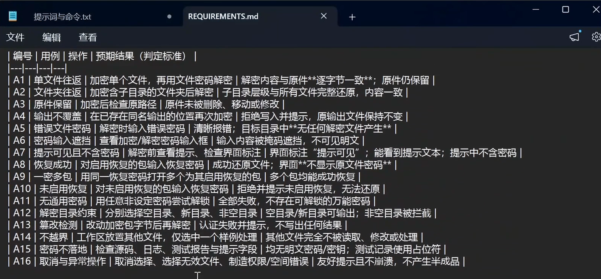
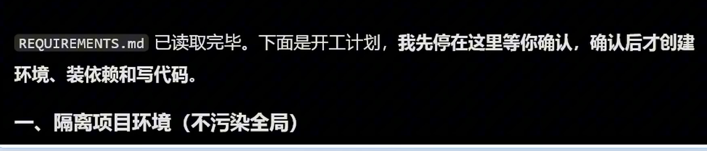
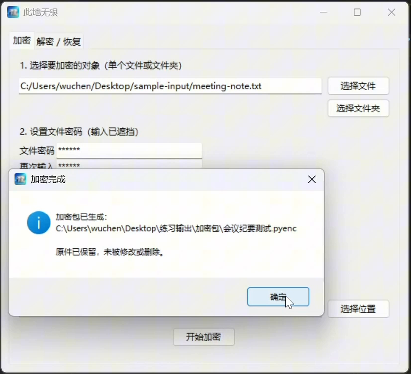
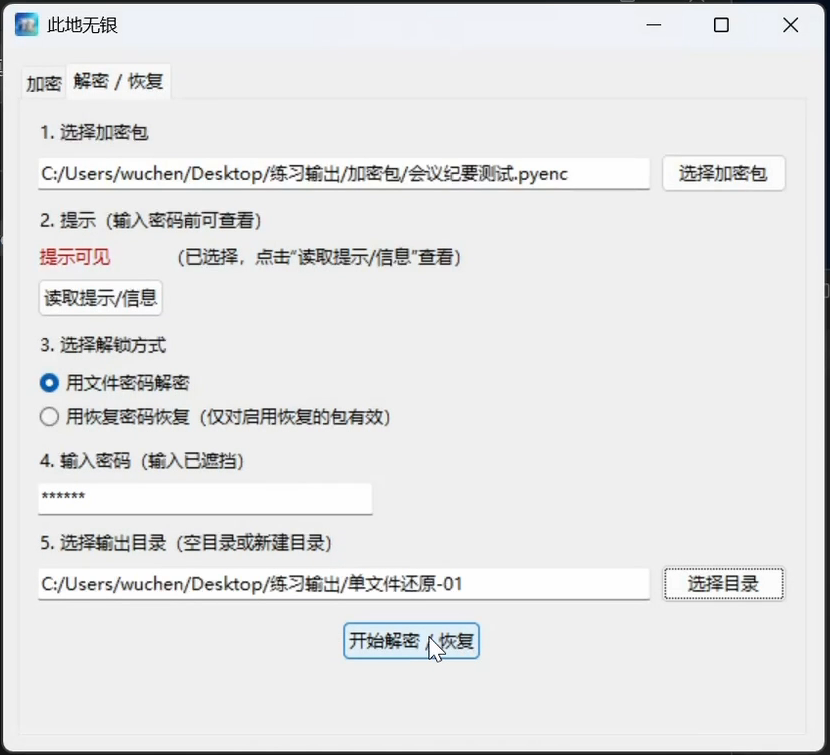
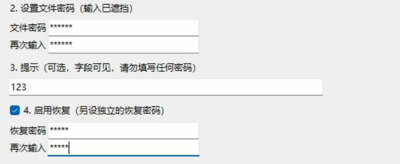
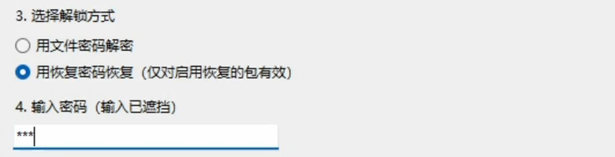
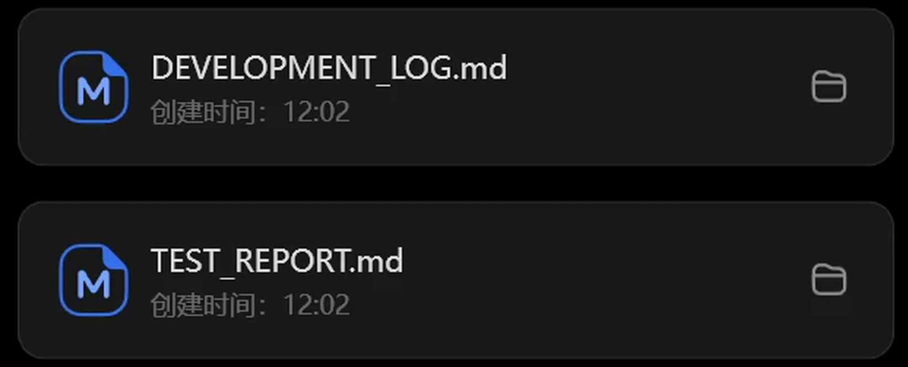

[返回第一课](../README.md) · [分步提示词](../提示词/README.md)

> 本文由已交付 v2.0 图文原稿整理，历史测试结果沿用原报告，不代表本轮重新测试。章节号保持完整手册编号。

# 用豆包开发文件加密工具

让 AI 帮你做 App 01 图文开发手册

这份手册带你在 Windows 上完成一个文件加密小工具。你不需要先学会写代码，但需要亲手选择文件、确认操作，并检查结果。豆包负责帮助整理需求、编写程序和排查问题，你负责决定要做什么，以及确认它是否真的做对。

完成后，你应当能在自己的电脑上打开工具，给练习文件生成加密包，再把内容还原；也能保留需求、使用说明和测试记录，让下一个 AI 接着修改。



适用对象：希望用 AI 把想法做成实用工具的人。演示环境：Windows 与豆包桌面端的工作页签。

这是一份小体积样例的学习项目。先用配套虚构文件练习，保留原件；不要把课堂原型直接当作公司重要资料的唯一保护工具。

AI创造加 编写整理　2026年11月　资料版本 2.0

# 01 先选一条学习路线

想学会从想法做成软件，请走路线 A；想先看看成品能做什么，请走路线 B。两条路线最后都要亲手完成加密、还原和内容核对。

## 路线 A 从需求开始做

按本手册第 02 至 05 节完成项目、Python 和需求准备；再在第 06 节确认计划并开工。每次只发送当前步骤的提示词，检查结果后再继续。

## 路线 B 先运行配套源码

跳到第 07 节，把随包源码解压到本机固定目录，重新创建项目环境，再运行 main.py。已经提供的代码不需要重新让 AI 生成，也不要把你正在跟课的新项目直接覆盖掉。

| 资料 | 用途 |
| --- | --- |
| 图文手册 | 在线阅读本文件；离线 Word 从本课网盘入口下载。 |
| 提示词 | 本课提示词目录提供在线阅读版和 TXT；Word 位于离线包。 |
| 源代码与图标 | 课堂代码、运行依赖、ICO 和 PNG 图标，以及项目文档。 |
| 练习文件 | 虚构文本和含子目录的文件夹；另附练习说明与检查清单。 |

建议先把整个资料包解压，避免在压缩包预览里直接运行。给项目和练习输出分别建目录；把路径放在你能找到的固定位置。

阅读顺序：项目与环境 → 需求与开发 → 加密与还原 → 排错与交付。在线按标题查阅；离线 Word 可使用导航窗格。

# 02 在工作页签选择自己的项目

准备一台 Windows 电脑，安装并登录豆包桌面端。官方入口是 https://www.doubao.com/download/desktop 。本课实际使用的是“工作”页签；如果你当前账号没有这个入口，先核对客户端和功能开放情况，不用普通聊天页面硬套后面的文件操作。


1. 在电脑上新建一个空文件夹，例如桌面上的 01python。这是你的项目位置。

2. 在豆包工作任务的输入框附近找到项目入口，选择这个文件夹。中下篇继续选同一个项目。

3. 让豆包说出当前工作区的完整路径，与你实际选中的文件夹核对。先确认位置正确，再允许创建或修改文件。



检查结果：你知道项目放在哪里，豆包显示的工作区也是它。界面里出现一个项目名字，不等于已经确认了完整路径。

# 03 先检查环境 再确认权限

打开提示词文档，先发 ①“检查本机 Python”。检查的对象是你自己的 Windows 电脑，不只是豆包内部能够运行代码的环境。让它返回实际版本、解释器路径和运行方式。

如果已经能运行，就直接做下一节的 Hello World。缺少或不能用时，再发 ②“需要时才安装”，让豆包先解释方案、来源和需要你操作的窗口。



1. 涉及安装、执行命令或写文件时，先看它准备做什么、要改哪里。

2. 跟做建议选择“始终询问”，再批准与你当前步骤一致的操作。视频中的“全部允许”是演示选择，不是完成本课的必要条件。

3. 看不懂时直接问：“请用普通人能懂的话说说会改什么、为什么需要改，先解释，不继续执行。”

检查结果：看到本机实际解释器的版本和位置；或清楚知道还缺什么。“我可以帮你安装”不算安装完成。Python 官方 Windows 下载页：https://www.python.org/downloads/windows/ 。

# 04 运行你的第一段 Python

确认环境可用后，发送提示词 ③“创建并运行 Hello World”。让豆包在项目中创建 hello.py，并用刚才核实的本机解释器实际执行。


1. 回到项目文件夹，确认 hello.py 确实存在。如果已有同名文件，先看内容，不直接覆盖。

2. 核对豆包给出的完整运行命令，确认运行的是你项目里的文件。

3. 看到 Hello, World!，且没有执行错误，才算这一步完成。能在普通 Windows 环境运行更有利于后面独立启动桌面工具。

## 如果结果不一样

找不到 Python：回到环境检查。找不到 hello.py：核对当前目录和文件名。只有代码没有运行结果：让豆包实际执行，或给出你能照做的具体命令。

```text
print("Hello, World!")
```

上篇的完成点：自己的项目能找到，自己的电脑能运行 hello.py。还没有做出加密工具是正常的，中篇才开始开发它。

# 05 把想法写成可检查的需求

继续原项目，发送提示词 ④“先整理需求”。这一步先生成 REQUIREMENTS.md，不急着写应用代码。双击该文件，用记事本或编辑器阅读；.md 是文本文档，不是需要运行的程序。



1. 输入是什么：只选择一个文件或一个文件夹，不自动处理整块磁盘。

2. 输出是什么：生成新的 .pyenc 加密包；还原时放进你选择的空目录，原件继续保留。

3. 失败怎么办：密码输错、输出重名、目录非空要提示，不能把失败说成成功。

4. 恢复怎么用：加密时预先启用并另设恢复密码，恢复的是文件内容，不是显示原密码。

检查结果：需求文档中的行为与你想的一致。尤其确认“原件保留”“不覆盖输出”“文件夹子目录保留”和“恢复条件”。有偏差就先改需求，再开工。

# 06 看懂计划后再让豆包开工

需求核对完，发送提示词 ⑤。让豆包先读需求、核对项目目录、列出准备创建的文件和需要安装的依赖，说明采用哪一个 Python，然后等你确认。



1. 看到计划后，检查是否仍在你的项目内，是否只做需求约定的小工具。

2. 用独立项目环境安装依赖，避免把别的项目一起改掉。看不懂“环境”时，可以把它理解成这个工具专用的一套运行条件。

3. 确认后单独发送“按刚才确认的文件结构和依赖开始实现”。等待文件创建和实际检查完成。

4. 让豆包按 README 的方法启动工具。亲眼看到窗口后，确认有加密、解密或恢复入口，再进入下篇的实测。

| 文件 | 你需要知道的用途 |
| --- | --- |
| main.py | 启动程序的入口。 |
| ui.py | 窗口和按钮。 |
| crypto_core.py | 文件加密与还原逻辑。 |
| requirements.txt | 运行需要安装的第三方库。 |
| README.md | 启动方法与操作说明。 |

检查结果：文件真实存在，窗口能打开。AI 显示“完成”只是交付提示，窗口打开也不等于所有功能都已经测过。

# 07 直接运行资料包里的源码

这一节适合路线 B，也适合对照自己的项目。进入本课的 源代码，应该能看到 main.py、ui.py、crypto_core.py、requirements.txt 和 assets。不要只拷走 main.py。

最省心的方式是把这个文件夹选为豆包项目，再发送提示词文档中的 S1“运行已有源码”。让它先读 README，核对本机 Python，再建立新的 .venv 和安装依赖。另一台电脑的 .venv 已从正式包中排除，不能直接搬来使用。

## 自己运行时的步骤

先打开这个项目目录，在文件资源管理器地址栏输入 powershell 并回车。只有已经确认本机存在 Python 3.13、py -3.13 指向该解释器时，才按下面示例操作。若你使用其他已确认兼容的解释器，让豆包换成它的真实完整路径。

```text
py -3.13 -m venv .venv
.\.venv\Scripts\python.exe -m pip install -r requirements.txt
.\.venv\Scripts\python.exe main.py
```

每条命令成功后再执行下一条。安装需要网络；若依赖安装失败，保留完整错误，让豆包查原因，不要连续更换多个环境。

本包保留 cryptography==50.0.2。Python 3.13 是原录制环境的一条可复现路线，不要求已经正常的电脑强行更换版本。

检查结果：打开“此地无银”窗口，看到两个标签页。后面全部使用配套虚构样例，不直接拿重要文件试验。

这份源码针对 Windows 窗口和 ICO 图标编写。不要把 Mac 上通过的核心逻辑检查当成 Windows 桌面窗口已经验证。

# 08 给单个练习文件加密

打开 练习文件/sample-input/meeting-note.txt，先记住里面的三行内容。再在资料包外新建一个“练习输出”文件夹，里面准备“加密包”和“单文件还原01”两个目录；还原目录先保持为空。

1. 切到“加密”，点“选择文件”，选 meeting-note.txt。

2. 输入文件密码，并再次输入确认。密码由你自己设置和保存，不发到评论区或聊天记录里。

3. 提示可以留空。要写提示时，只写帮助回忆的内容，提示是可见的，不能写密码。

4. 第一轮先不启用恢复。点“选择位置”，在练习输出/加密包里保存为 meeting-note.pyenc，再点“开始加密”。



检查结果：新加密包确实存在，原 meeting-note.txt 还在且内容不变。两次密码不同就重新输入；文件重名就换一个输出名称，不覆盖已有结果。

# 09 用密码还原并核对内容

1. 切到“解密 / 恢复”，选择刚才生成的 .pyenc 文件，不要选择原来的 TXT。

2. 点“读取提示/信息”查看提示和恢复状态，解锁方式选“用文件密码解密”。

3. 输入加密时设的文件密码，选择空的“单文件还原01”目录，点“开始解密 / 恢复”。

4. 出现完成提示后，打开还原目录里的 meeting-note.txt，与原件逐行比较。



必须核对三行文字：演示用会议记录；时间：周五下午三点；议题：整理活动报名资料。只有弹出成功窗口，还不能代替内容核对。

再试一次错误密码，确认没有产生还原文件。重复正确测试时换一个新的空目录，不往已经有结果的目录里继续写。

# 10 文件夹与恢复密码怎么试

接下来选择 sample-input/demo-folder 做文件夹练习。它包含 README.txt，以及 notes 子目录里的 checklist.txt。还原后不仅要有顶层文件，还要能打开 notes/checklist.txt。



1. 在“加密”页选择 demo-folder，设置并确认文件密码。勾选“启用恢复”，另设一个与文件密码不同的恢复密码，再次确认。

2. 把新包放在“练习输出/加密包”中，换一个新名称，例如 demo-folder-recovery.pyenc，然后加密。

3. 在“解密 / 恢复”页选新包，选择“用恢复密码恢复”，输入恢复密码，输出到新建空目录“文件夹还原01”。

4. 打开还原后的 demo-folder，核对两个文件及 notes 子目录。再次检查原件仍在。



没有预先启用恢复的包，不能事后靠恢复密码打开；恢复功能也不会告诉你原文件密码。第一次练习不成功，就保留报错，不用重要文件反复试。

# 11 遇到报错 怎样让豆包帮你修

视频里的闪退是录制电脑遇到的案例。你的工具正常，就继续做功能检查，不用主动制造相同错误，也不用照着更换 Python。

真正遇到问题时，把“在哪里、做了什么、最后看到什么”说清楚。截图里保留报错和相关窗口即可，发送前检查是否露出了密码或不相关的个人信息。

## 把修复和复测连起来

让豆包说明会改哪些文件或环境；确认后再执行。改完回到刚才出问题的同一页面，按同样顺序重做一次，不能只看它说“已修复”。

## 课程里的复测方法

原来在密码框按退格会卡住并退出，修后就回到相同输入框输入、按退格，观察星号变化和窗口是否仍在。再完成正常加密还原，确认修改没有影响主流程。

```text
我在【哪个页面或按钮】操作。
先【第一步】，再【第二步】。
我以为会【预期结果】，实际是【真实现象或报错】。
能否再次出现：【能 / 不能 / 还没试】。
请先分析原因，给最小修复方案，等我确认后再改。
```

如果换了环境仍出错，提供实际 Python、Tk、输入法和启动命令。不要只凭“也闪退”就判断一定是同一种原因。对应提示词 S2，可直接填自己的情况。

# 12 做一个桌面快捷入口

基本功能测过后，可以给工具做桌面快捷方式。先保持项目目录不动，再发提示词“做桌面快捷方式”。让豆包说明目标程序、工作目录、桌面位置和要改的文件，确认后执行。


1. 代码加载图标使用 assets/app.ico。app_256.png 用于预览，icon_source.png 留作图标原图。替换图标时保留运行代码需要的文件名。

2. 快捷方式应该启动这个项目里的解释器和 main.py，工作目录也是这个项目。不要把录制电脑的绝对路径照抄到自己电脑。

3. 先关闭已打开的工具，再从桌面双击新快捷方式，确认能重新开窗；只看到桌面多了一个图标还不够。

快捷方式不是独立安装包。移动或删除项目文件夹后，它可能失效；把一个 .lnk 文件发给别人，通常也不能直接运行。本课没有交付免安装 EXE。

# 13 把项目交给下一个 AI

发送提示词 ⑦，让豆包依据真实开发过程和你反馈的实测结果整理文档。不要把未测试的内容写成“通过”。



| 文件 | 交接时解决的问题 |
| --- | --- |
| README.md | 怎么准备环境、怎么启动和使用。 |
| REQUIREMENTS.md | 要做什么、哪些行为必须满足。 |
| DEVELOPMENT_LOG.md | 做过什么、改过什么、还剩哪些限制。 |
| TEST_REPORT.md | 哪些真测过、结果如何、哪些还没测。 |

换一个 AI 或开新会话时，先给它整个项目或可访问的项目目录，再让它读这四份文档。只告诉它文件名，它不一定能看到文件。

可直接说：“先读项目里的 README、需求、开发日志和测试报告，告诉我当前完成到哪里、还有哪些待检查。先理解，不改代码。”

资料交接帮助 AI 了解背景，并不等于自动继承上一个聊天的记忆。下一项改动仍要重新确认需求和检查结果。

# 14 用这张清单完成自己的验收

逐项亲手操作后再勾选。右侧“我的结果”可以写完成时间、输出位置或错误现象；没有做过就留空，不照抄示例报告里的通过。

| 检查项 | 应该看到什么 | 我的结果 |
| --- | --- | --- |
| 项目和环境 | 知道项目位置，hello.py 在本机真实运行。 |  |
| 桌面窗口 | main.py 能启动，两个标签页可切换。 |  |
| 单文件加密 | 生成新的 .pyenc，原文件仍在。 |  |
| 单文件还原 | 新空目录内有文件，三行内容一致。 |  |
| 文件夹还原 | README.txt 和 notes/checklist.txt 都在。 |  |
| 密码不一致 | 两次确认不一致时提示，不当作成功。 |  |
| 错误密码 | 显示错误，未生成解密文件。 |  |
| 已启用恢复 | 恢复密码能还原对应包中的文件。 |  |
| 未启用恢复 | 不能用恢复密码事后解锁。 |  |
| 输出保护 | 同名包或非空还原目录被拒绝。 |  |
| 修复复测 | 原故障动作重做，观察实际结果。 |  |
| 桌面入口 | 关闭窗口后，双击快捷方式能重开。 |  |
| 交付记录 | 四份文档存在，已测与未测分开。 |  |

内容核对参考：单文件应是会议记录的三行；文件夹应有两份 TXT 和 notes 子目录。字节校验可让豆包帮你比较，但也要亲手打开看一遍。

独立可填写清单在 练习文件/练习检查清单.md。测试时给每轮还原新建空目录，避免重复结果影响判断。

# 15 常见卡点怎么处理

## 看不到工作页签

先核对是否为豆包桌面端，以及当前账号是否具备本课需要的入口。界面与功能可能变化；没有文件操作能力时停在这里，不把聊天生成文字当作实际执行。

## AI 说做完了 但找不到文件

让它返回当前工作区完整路径和实际文件列表，再在资源管理器中核对。不要只看聊天中的文件名。

## 依赖安装失败

确认运行的是项目 .venv 中的 Python，完整复制错误信息，检查网络、官方包来源和版本兼容。不要把 pip 安装到另一个全局解释器。

## 双击 py 文件没有反应

先用 README 中的命令从终端启动，保留报错。等命令能稳定开窗后，再做快捷方式。

## 双击 pyenc 提示选择应用

.pyenc 是这个工具生成的加密包，不是普通文本。回到工具的“解密 / 恢复”页手动选择它，不随意关联记事本。

## 提示输出目录非空

换一个新建空文件夹，不要为了继续测试而删除你不确定用途的旧文件。

## 恢复密码不能用

核对加密时是否启用了恢复，是否选对加密包，输入的是否是那次另设的恢复密码。未启用恢复的旧包不能补开。

## 关了豆包之后不能运行

核对真正使用的是本机解释器还是豆包内部环境；再检查快捷方式目标、工作目录和项目是否被移动。

# 16 了解源码和当前验证范围

你拿到的是课程源代码，不是经过完整安全审计的商用加密产品。核心算法调用 cryptography 库；学习重点是需求、实现、验证和交付，而不是自行设计加密算法。

## 适用范围

原型把归档数据放在内存中，并在窗口主线程执行加解密。先用小体积虚构样例；大文件、并发写入、恶意构造包和异常磁盘环境不属于本次验证范围。

## 密码和提示

提示是公开可读字段，别写密码。程序只拦截提示与密码完全相同的情况，并不能替你识别所有泄露密码的写法。文件名等包头信息也不是匿名化设计。

## 测试报告怎么看

源码目录里的 TEST_REPORT.md 记录本次实际环境和18项检查，同时列出仍需人工验证的项目。它是这份包的证据，不是你自己电脑已通过验收的证明。

| 对象 | 本资料包的状态 |
| --- | --- |
| 程序代码与图标 | 从作者拷来的工程按文件指纹保留，未改业务逻辑。 |
| 运行依赖 | requirements.txt 保留 cryptography==50.0.2。 |
| 核心逻辑 | 整理时在 macOS、Python 3.12.14 下重测18项，全部通过。 |
| Windows界面和输入法 | 录屏提供操作实例；本次整理未在新Windows电脑重跑。 |
| 快捷方式 | 必须按你的项目路径在本机重新建立并双击验证。 |

# 17 做完以后 留下一份能继续用的项目

用你自己的话描述一次完整结果：我选了哪个练习文件，输出放在哪里，怎样确认还原内容一致，遇到了什么问题，以及怎么复测。能说清这些，就已经开始掌握指挥 AI 做工具的方法。

## 下一次可以练什么

先复制一份项目备份，再提出一个小改动，例如让按钮文字更容易懂，或让使用说明更清楚。一次只改一个目标，改完重新做单文件和文件夹验收，确认主功能还在。

## 给接手 AI 的任务

请先读现有文档，复述我要改的地方、可能影响的文件和检查方法。等我确认后再修改。修改完成后，更新开发日志和测试报告，不把没有做过的检查写成通过。

本手册的操作配图来自第一集作者精剪上、中、下篇；截图里的路径、用户名、文件名和界面状态只作定位参考，跟做时使用自己的目录和配套样例。图文原稿与配图另附在本目录，方便查阅和后续图文整理。

官方入口与查阅日期 2026年11月16日：

豆包桌面端 https://www.doubao.com/download/desktop

Python Windows 下载 https://www.python.org/downloads/windows/

cryptography 50.0.2 https://pypi.org/project/cryptography/50.0.2/

资料有更新时，优先看包内 README 和版本号；不要把旧截图中的版本、权限选择或机器路径当作固定答案。
