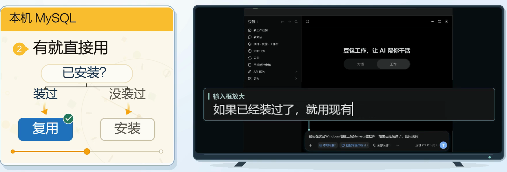
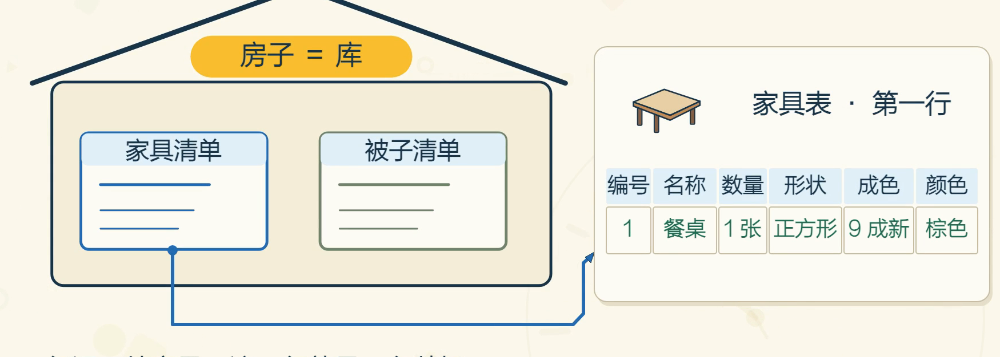
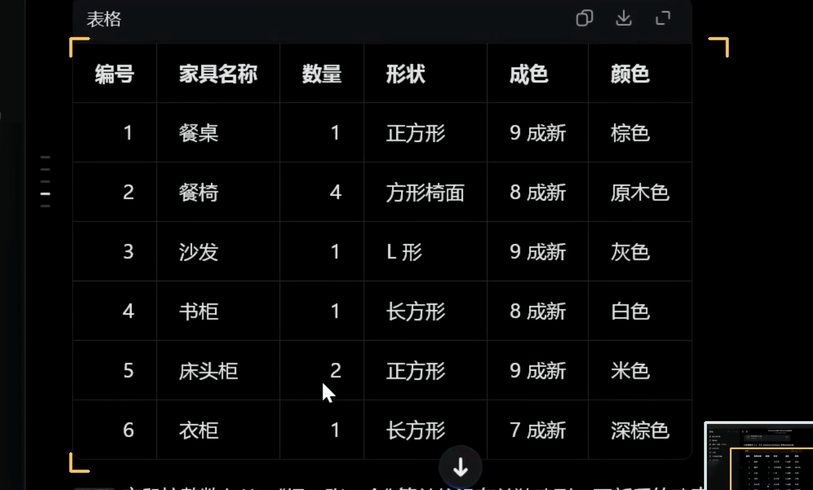
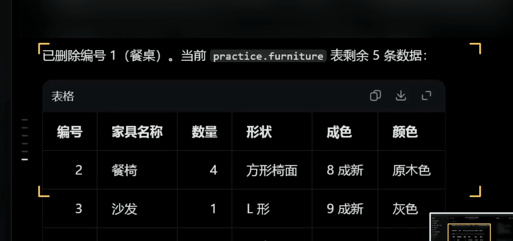
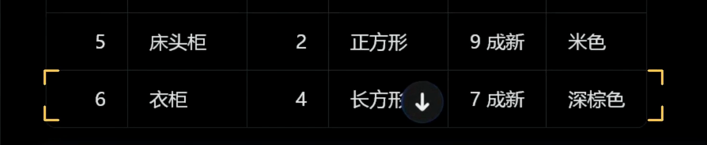

# 用豆包在自己的电脑上存下第一条数据

搬家前把一张餐桌登记到清单里，关掉窗口，明天再打开还能找回来。今天就用一张家具表把这件事做一遍。学到能从本机查回「编号 1、餐桌、数量 1」，你已经存下了自己的第一条数据。

## 准备什么

准备一台能联网的 Windows 电脑，登录豆包电脑版，找到能操作本机文件和工具的「工作」入口。准备一个新的空文件夹。已有 MySQL 也可以跟做。

## 选择你的起点

第一次做，从下面的第 1 步建项目开始。已经有能连接的本机 MySQL，可以先发[分步提示词](../提示词/README.md)里的「验收」，成功后直接从第 3 步登记餐桌开始。每次都在同一个豆包任务中操作。

# 1  给豆包一个练习目录

1. 打开豆包电脑版，选「工作」。在 Windows 桌面右键新建文件夹，命名为「数据库练习」。

2. 在工作页的输入框下找到「项目」，点「创建新项目」。名称写「数据库操作练习」，点「添加本地文件夹」，选中刚创建的目录，再点「创建」。

完成时能回到豆包工作页并看到已选项目。若只有普通聊天，先确认使用的是有本机操作能力的电脑版入口。

# 2  发一句话安装并核对连接

把[分步提示词 01](../提示词/README.md) 发给豆包。它先检查电脑，装过就复用，缺少才安装。遇到系统确认窗口，看到预期的 MySQL 软件和来源后再确认。只有电脑提示重启时才重启，然后回到原任务继续。

## 看到什么算装好

发「验收」提示词，让豆包实际连接本机并查询服务端版本。安装包下载完成后还要核对这一步。版本号以你的实际返回为准，端口也可能与示例不同。

若豆包只给你一段命令，提醒它在当前工作任务中执行并贴回结果。遇到报错，将练习资料内的[安装经验 TXT](../练习文件/MySQL_Windows安装经验教训.txt) 和具体报错交给豆包。

# 3  建一张家具表并找回餐桌

发提示词 02。练习库 practice 好比一座房子，家具和被子各有一张登记清单，每张清单都是一张表。家具表 furniture 里的每一行登记一种家具，每一列记录它的一项信息。

## 让豆包写入后再查一次

表里填编号 1、餐桌、数量 1、正方形、9 成新、棕色。看豆包实际从练习表查回的结果，逐列和下图对照。若查不到，先让它报告当前连接的库名、表名和已存在的编号。

# 4  一次添五种家具并查全表

现在表里只有餐桌。发提示词 03，按原来的六个字段，依次增加餐椅、沙发、书柜、床头柜和衣柜。接着发提示词 04，用中文让豆包按编号顺序列出全部数据。

## 数行，也看数量

四把餐椅占一行，数量填 4。两只床头柜也只占一行。若编号重复或行数不对，先查现有数据，对照练习文件里的六行样例，再决定需要补哪一行。

# 5  按编号删除和修改

发提示词 05，只删编号 1 的餐桌。查回全表后应该只剩五行，原来编号 2 的餐椅仍然是 2。编号用来找到同一条记录。

发提示词 06，把编号 6 的衣柜从 1 个改成 4 个。改完再看同一行，核对编号、名称和数量，还可以顺手对照另外三个字段。

关掉对话视图后，回到原任务，让豆包重新连接同一台 MySQL 并查编号 6。如果仍是 4，你看到的是数据库保存下来的结果。

[回到第三课](../README.md)
