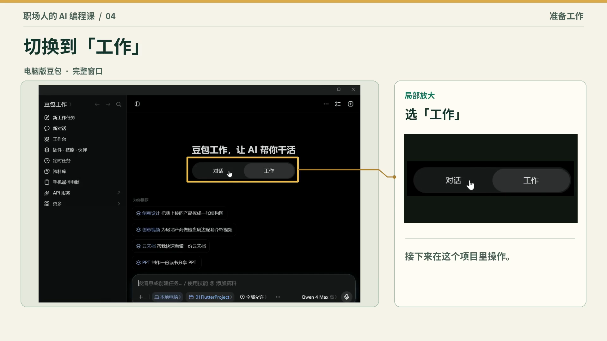
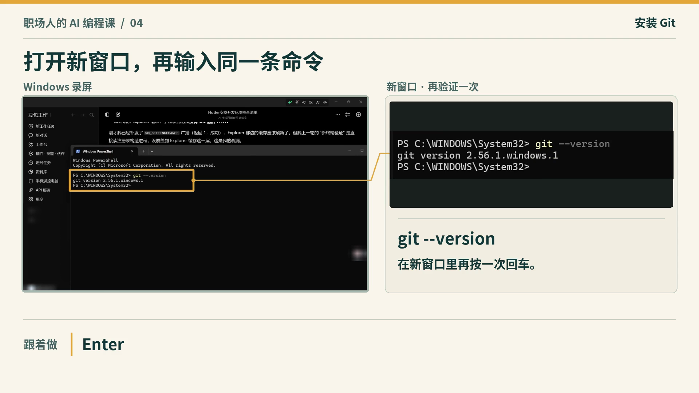
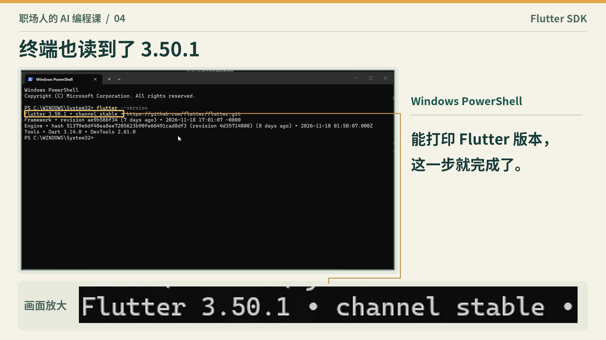
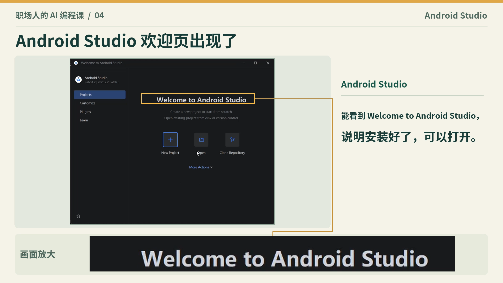
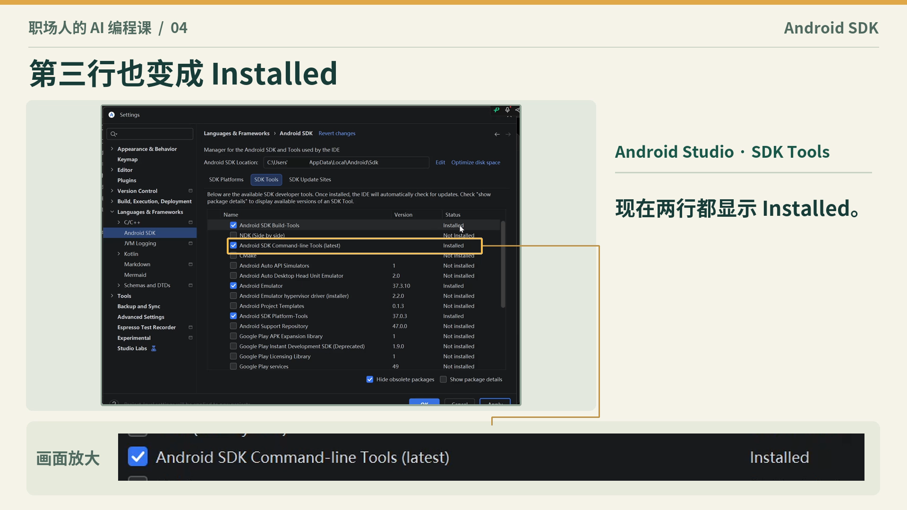
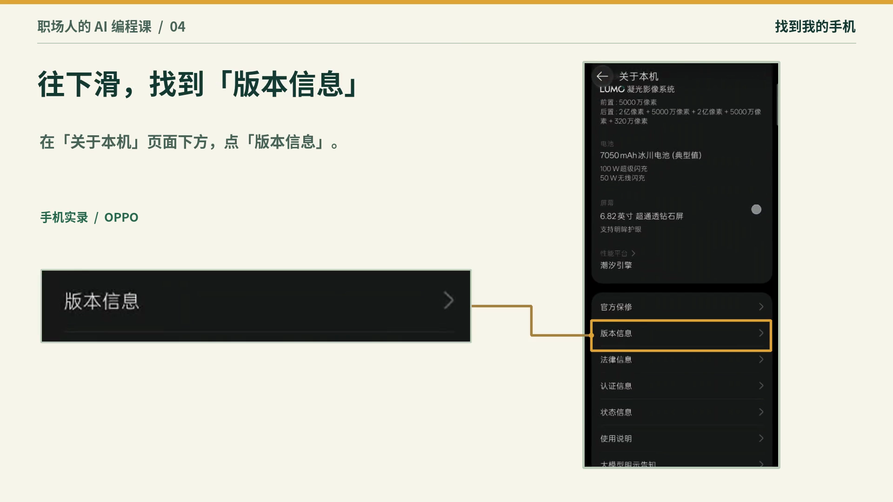
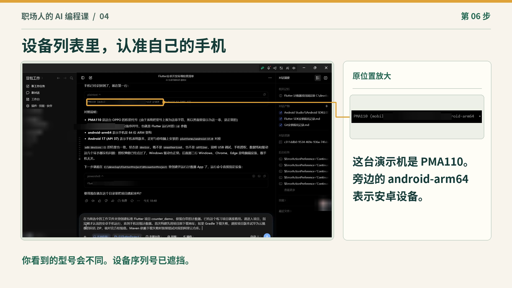
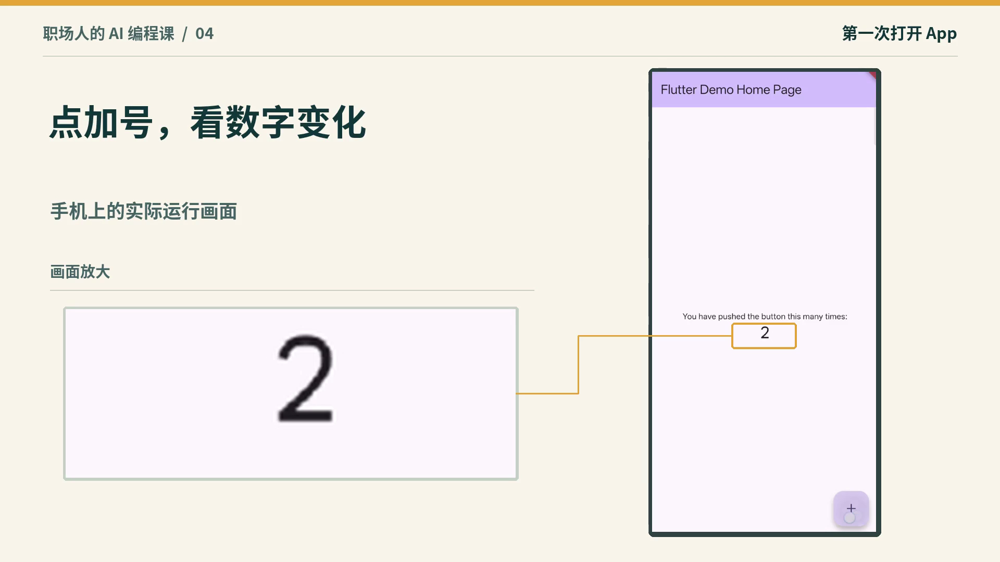
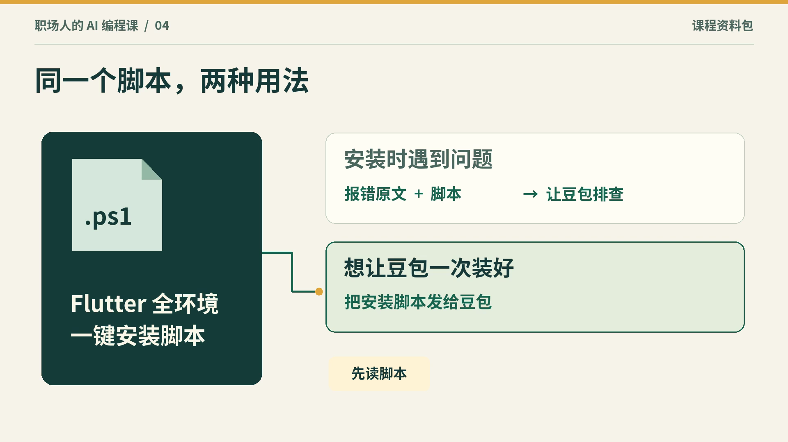

# 第四课 Flutter 安卓真机跟做手册

这节课在 Windows 10 或 11 的 x64 电脑上操作。准备一部安卓手机和一根能传数据的 USB 线。我们先让豆包装开发工具，再把 Flutter 的默认计数器装到手机。点两次加号看到 2，最后把 App 改成你喜欢的名字。

用 Win + E 打开文件资源管理器，先到你平时保存项目的目录，再按 Ctrl + Shift + N 新建文件夹。演示项目目录叫 01counterProject，可以换个名字。打开豆包电脑版，选择「工作」，在项目选择里添加刚建的文件夹。

打开分步提示词，发送第 01 条。只有想指定安装目录时才追加「01A 指定目录」，先把示例项目路径换成你自己的。豆包列出已可用、缺少和待配置项后，按 02 到 05 逐项补齐。已经可用的工具直接验证。

## 安装 Git 和 Flutter SDK

发第 02 条，等豆包给出安装回执。按 Win 搜索并打开新的 Windows PowerShell，输入 git --version。看到 git version 后跟数字即通过。若报找不到命令，复制整段报错给豆包，让它核对安装路径和用户 Path。完全退出旧终端，再打开一个新窗口重试。

接着发第 03 条。如果需要新装，按电脑架构选择官方稳定版，在可写且路径无空格的目录解压，把 Flutter 的 bin 加进用户 Path。等下载、校验和解压完成，重新打开 PowerShell 运行 flutter --version。片中 3.50.1 是录制时的版本。

## 安装 Android Studio 和 SDK

发第 04 条，等安装程序下载并打开。按首次向导操作，确认你同意的许可，等组件日志显示完成，再点 Finish。看到 Android Studio 欢迎页后，核对内置 Java 版本。若已有可用的 Android Studio，可以沿用。

发第 05 条。欢迎页可从 More Actions 找到 SDK Manager，也可打开 Settings 搜索 Android SDK。核对 SDK Platform、Build-Tools、Command-line Tools、Platform-Tools，按 Flutter 的实际要求补缺。出现许可时，由你阅读并确认。运行 flutter doctor -v，Android toolchain 一项通过后再接手机。

## 打开 USB 调试并确认手机

手机设置里先找「关于本机」和「版本号」。演示机是 OPPO，入口在「关于本机 → 版本信息 → 版本号」。找不到时，把品牌和型号告诉豆包。连续点版本号，直到手机提示开发者模式已启用。返回设置进入「开发者选项」，打开 USB 调试并确认。

让手机保持解锁，用数据线连接电脑。如果手机询问是否允许这台电脑调试，核对当前电脑后点「允许」。USB 用途若停在「仅充电」，试选「传输文件」。发第 06 条让豆包运行 flutter devices。没有手机型号时，先查线、调试授权和对应的 Windows USB 驱动。

## 跑通计数器并给 App 起名

发第 07 条，让豆包在当前工作文件夹下创建 counter_demo，再指定刚才识别到的手机运行。首次构建会下载 Gradle 和依赖。遇到下载失败，先核对项目 wrapper 指定的版本以及分发包类型，再考虑同版本镜像和官方校验值。

能从 0 点到 2 就通过。发第 08 条前，把「随手数」换成你的名字。要求豆包保持原应用 ID 和计数功能，重新构建安装。回到手机桌面核对名字，再打开点两次。想换图标时发第 09 条并附上图片。

## 用脚本做排错参考

遇到安装问题时，可以让豆包先读片尾脚本，用第 10A 条对照错误位置。发帖或反馈时保留命令和完整报错，把用户名、手机序列号和跟课程无关的信息遮住。

换一台 x64 Windows 电脑时可以使用第 10B 条。先让豆包核对已有工具、目录和修改范围，确认后再运行。本包脚本 v1.5 是另一条安装路线，固定 Flutter 3.29.0。它可设置用户环境变量、JDK 和 Gradle 镜像，并可在临时目录构建验证。

优先沿用本机已经可用的 Flutter 与工具链。录制使用 Flutter 3.50.1 和 Gradle 9.5.0。把不同版本的 SDK、JDK 和 Gradle 随意混用，容易遇到构建失败。

最后在新终端确认版本和 Android toolchain，再由 flutter devices 确认真机。在手机上验证计数和桌面名字。本次整理对照实际成片和归档素材，未重新执行 Windows 安装或真机部署。
