# 把自己做的 App 装进 iPhone

让 AI 帮你做 App · 第 05 课。你会用一台 Mac 和豆包做出「随手数」：在手机上点两次加号，数字变成 2，最后拔掉数据线也能重新打开。

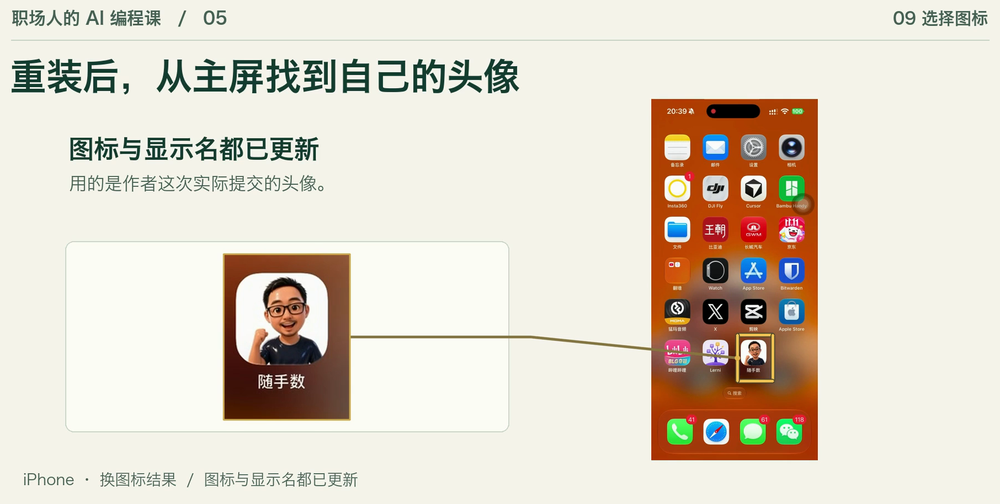

## 先把三样东西放到手边

准备一台能运行兼容 Xcode 的 Mac、一部能解锁的 iPhone，以及一根能传输数据的线。备好平时在 App Store 下软件的苹果账号。

## 选一条起步路线

1. 从零跟做：从 01 开始，在第 04 条选 B，让豆包生成默认计数器。

2. 先运行示例：复制资料中的 counter_demo 文件夹，在第 04 条选 C。前面的环境检查和后面的配对、签名照做。

3. 手里已有第四课源码：在 Mac 上另存副本，第 04 条选 A。第四课的 APK 是安装产物，保留源码的同学才走 A。

先打开 02-提示词文档里的「分步提示词.txt」。它就是视频里使用的豆包分步提示词。每次只复制一段，读完“检查结果”再发下一条。

## 01｜让豆包先检查这台 Mac

1. Finder 中进入你有写入权限的位置，按 Shift + Command + N 新建练习文件夹，例如 flutter_develop。

2. 打开豆包电脑版的「工作」，新建项目并选择刚建的文件夹。以后回到同一项目操作。

3. 打开提示词 TXT，找到 01，复制两个边界标记之间的正文。回到豆包底部输入框，按 Command + V 粘贴，回车发送。

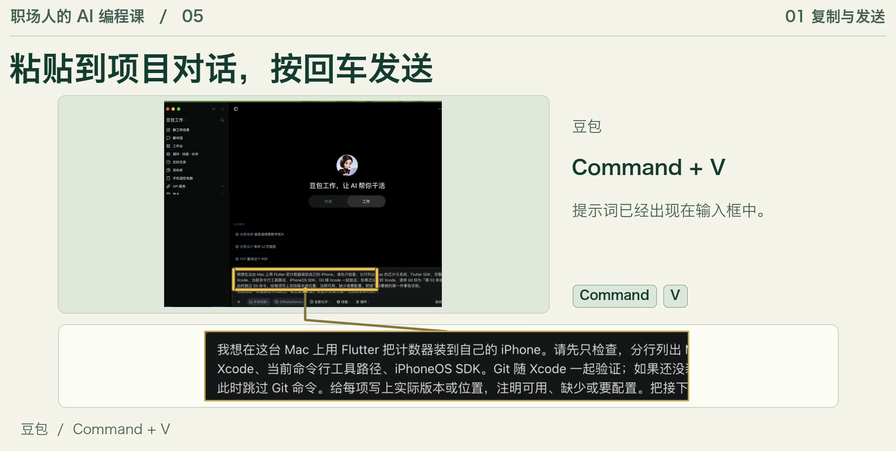

## 怎样判断可以继续

让豆包分别列出 Mac 芯片、macOS、Flutter SDK、完整 Xcode、开发工具路径和 iPhoneOS SDK。看到“缺少”就记下项目名。Git 随 Xcode 核验，本课可直接进入 02。

如果助手只给出建议，请它报告实际执行过的命令和输出；若已经安装了工具，先复核现有版本。

## 02｜装好 Xcode，再回到豆包核验

从 Mac App Store 搜索 Apple 的 Xcode。先在 Apple 的 Xcode 系统要求页核对 macOS 和 iPhone 系统兼容范围。本课实录商店显示 10.35 GB，iOS 组件另外下载；请以自己屏幕的体积和进度为准。

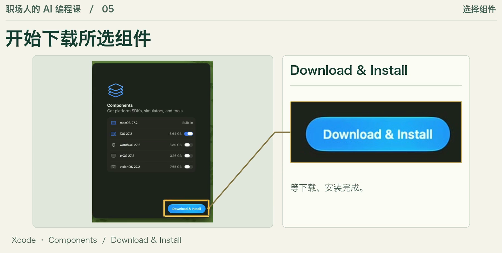

首次打开按提示同意许可、安装所需工具。若没有弹窗，从 Xcode → Settings → Components 检查 Platform Support 下的 iOS；缺少时点对应行的 Get。如只显示可选 Simulator Runtime，它用于在 Mac 上模拟设备。

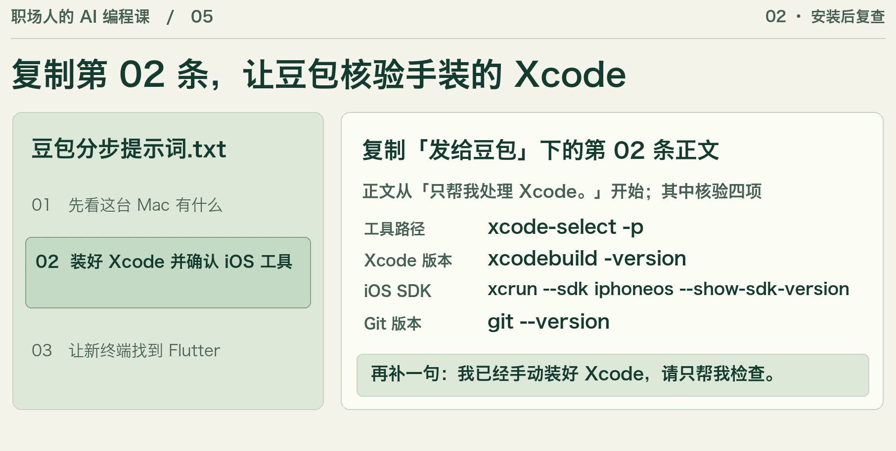

检查四项：xcode-select -p 指向完整 Xcode；xcodebuild -version、xcrun --sdk iphoneos --show-sdk-version 和 git --version 都返回版本。看到 Apple Git 即可继续。

## 03–04｜认清 SDK 和工程两个目录

先发 03，让豆包检查 Flutter 并按芯片架构选择 SDK。本次在 Apple 芯片 Mac 上使用 3.50.1。网盘版的 05-安装包附录制同版 arm64 官方归档；Intel Mac 应选 x64，已有可用版本先验证。

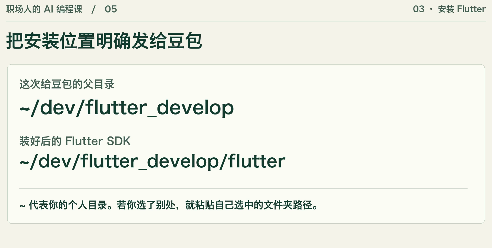

在 Finder 选父目录，按 Option + Command + C 复制实际路径。把它告诉豆包，配置 SDK 的 bin 到 PATH。新开终端运行 flutter --version 和 flutter doctor -v，检查 Flutter 与 Xcode 两项。

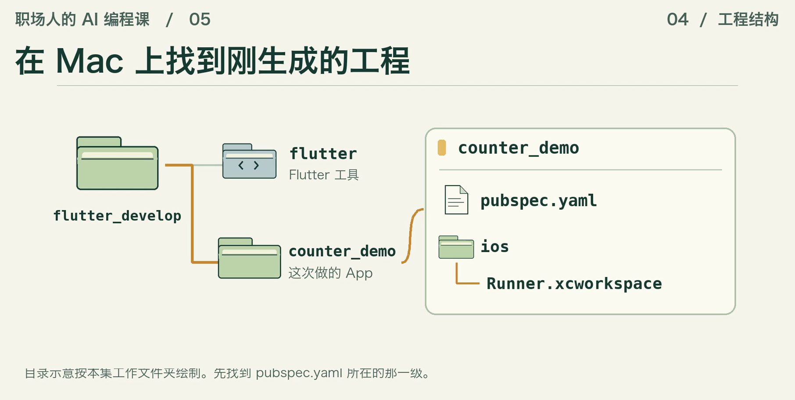

按 04A／04B／04C 三选一。看到 Xcode 左侧蓝色 Runner 再继续；没看到就告诉豆包：“请用 Xcode 打开刚才的计数器项目 ios/Runner.xcworkspace。”

## 05–06｜配对手机，选对签名团队

解锁 iPhone，用数据线接 Mac。Mac 询问配件连接时点允许，手机询问是否信任这台电脑时点信任。Xcode 27 从 Xcode → Open Developer Tool → Device Hub 查看并配对；旧版可从 Window → Devices and Simulators 进入。

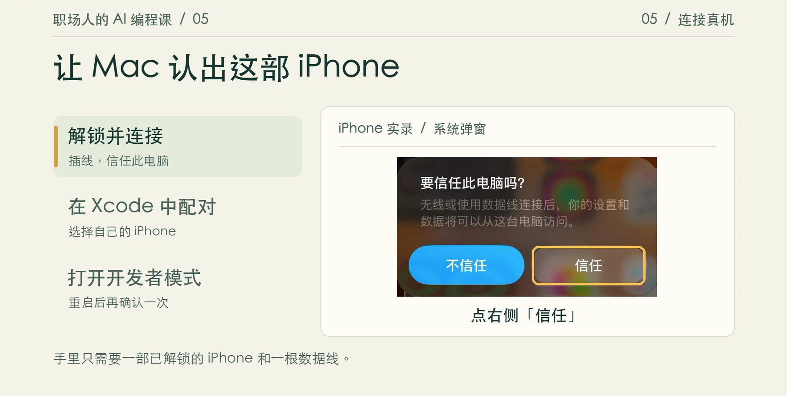

回到 iPhone 设置 → 隐私与安全性 → 开发者模式，开启后重启，再点启用（菜单名称因系统而异）。发 05，核对 flutter devices 的物理 iPhone 行。

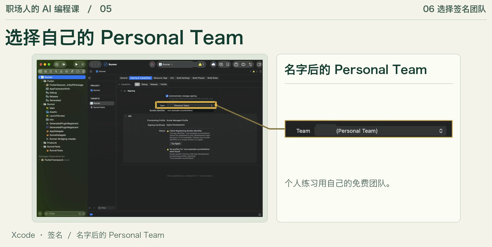

发 06。在 Xcode → Settings → Apple Accounts 登录平时下载 App 的账号。开启 Automatically manage signing，Team 选自己名字后的 Personal Team。免费个人团队可用于自己的设备。

## 06–07｜处理编号冲突，第一次打开

给自己的练习工程填写独特的 Bundle Identifier。若出现 Failed Registering Bundle Identifier，先处理这条；下面的 No profiles 可能随它一起消失。保留 Personal Team，改完编号点击别处等待刷新。

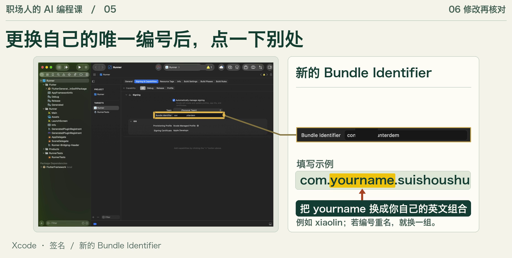

顶部运行目标选手里的 iPhone，发 07。若提示 device is locked，解锁手机再重试。首次打开若提示“不受信任的开发者”，到设置 → 通用 → VPN 与设备管理 → 你的开发者 App，信任自己签名的项目。

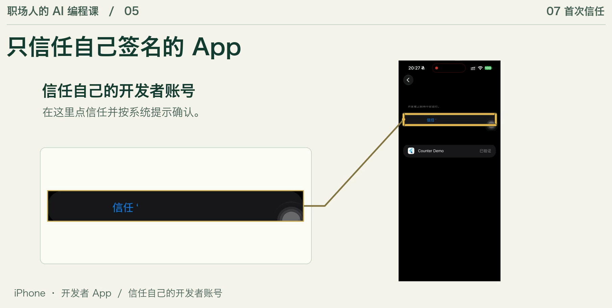

等计数页出现，从 0 开始点加号。第一次应为 1，第二次为 2；在随包练习表里记下三次读数。

## 07–09｜验收计数，改名和图标

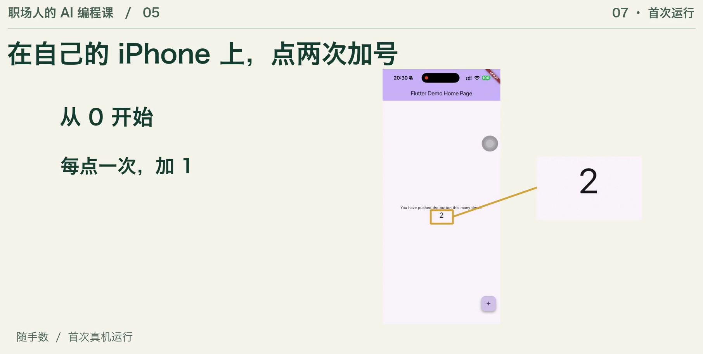

## 先改图标下面的名字

发 08，让豆包改 iOS 的 Display Name，或 Info.plist 中的 CFBundleDisplayName 为「随手数」。项目编号和页面里的英文标题可保持原样。改名需要完整重装，再回主屏核对。

## 再选择是否换图案

若要换，发 09 并附 03-源代码与图标／图标里的「随手数-iOS图标-1024.png」，也可换自己的图。豆包按 Assets 中 AppIcon 的尺寸生成图标。录制用的头像与原版图标资源集另收在「成品对照」里。

重建并安装后，从主屏核对名字和图案。若这一轮只改名，09 可以跳过，接着做 10。

## 10｜断开电脑，从主屏独立启动

刚刚通过开发工具装的是调试版。先拔线，结束这次调试运行，从主屏点图标。如果出现图中的英文提示，就按第 10 条换成 Release 安装。

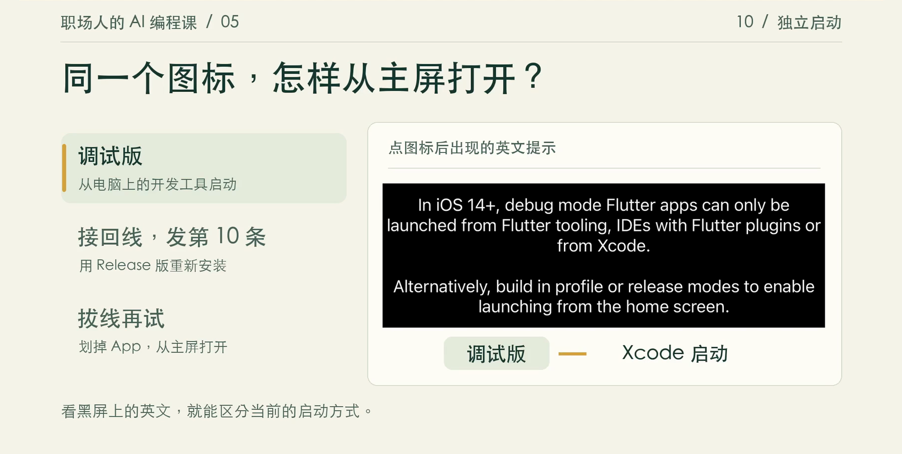

接回同一部 iPhone 并解锁，发 10。让豆包结束之前的运行，在项目根目录执行 flutter run --release -d 并传入这部手机的实际设备 ID。沿用原 Team 和编号，等安装结束。

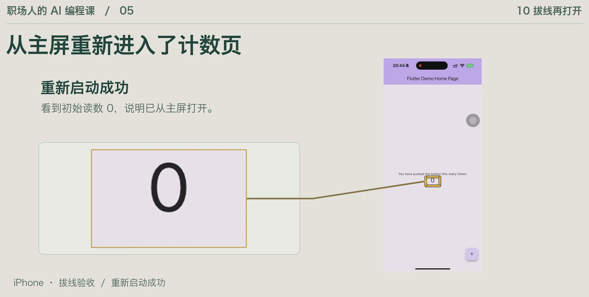

重新点两次加号，确认回到 2。这个计数器只在当前进程保存数字，彻底退出后会归零。

## 七天以后｜把原工程装回来

免费 Personal Team 给这次测试安装签发的描述文件有效期为 7 天，从签发时算起。到期后仍然可以用原来的 Mac 和工程安装。

1. 接回原 iPhone 并解锁，打开之前的 counter_demo，核对 pubspec.yaml、Team 和 Bundle Identifier。

2. 在 TXT 末尾复制「七天到期后重装」，让豆包重新构建、签名、安装。需要验证身份时，自己在苹果系统窗口输入。

3. 看到安装完成后拔线，划掉 App，从主屏重开并再次点到 2。

## 还卡住时怎么求助

用 TXT 最后一段「报错时单独发」，填写步骤编号、上一项已经看到的结果和第一条完整错误。截图遮住账号、设备 ID 及个人路径。练习文件夹里有一条虚构错误供对照。

Apple 个人团队规则、Xcode 兼容表及 Flutter 官方归档入口收在随包「安装与官方入口.md」。
